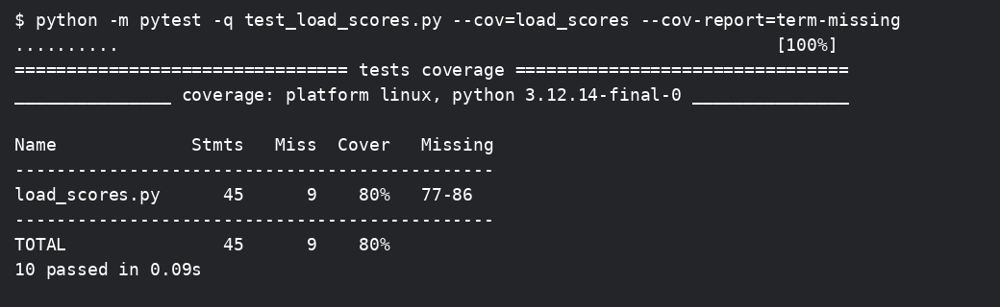

# 성적 CSV 읽기와 테스트

## ① 무엇을 하나요
성적 파일에서 유효한 (이름, 점수)와 제외한 줄의 번호, 내용, 이유를 돌려줍니다.

## ② 왜 만들었나요
scores.csv에는 김하나가 88점과 91점으로 두 번 나오고 105점과 빈 점수도 섞여 있습니다. 같은 이름의 두 기록을 모두 보존하면서, 성적으로 쓸 수 없는 줄을 다시 찾으려고 만들었습니다.

## ③ 어떻게 쓰나요
Python 3.12에서 확인했습니다. 저장소를 내려받고, load_scores.py가 있는 폴더에서 실행합니다.

    git clone https://github.com/temocomet-k/ai-programming-week12.git
    cd ai-programming-week12
    python -m pip install pytest pytest-cov
    python load_scores.py scores.csv

유효한 성적 5개, 제외한 줄 5개가 출력됩니다.

## ④ 어떻게 테스트하나요

    python -m pytest -q test_load_scores.py --cov=load_scores --cov-report=term-missing

결과: 10 passed, 80%. 아래 이미지는 실행 출력입니다.



AI 비교와 함정 실험은 따로 실행합니다.

    python -m pytest -q test_ai_A.py
    python -m pytest -q test_ai_B.py
    python -m pytest -q test_ai_bug.py

마지막 실험에서는 배포된 find_max의 버그로 2개가 실패합니다.

## ⑤ 파일 구성
- load_scores.py / scores.csv / empty.csv / weird.csv — 배포 함수와 성적 파일
- test_load_scores.py — 8개 기본 사례와 2개 추가 사례
- test_ai_A.py / test_ai_B.py / test_ai_bug.py — 코드·명세로 만든 비교 테스트와 함정 실험 테스트
- bug3_logic.py — 함정 실험에 사용하는 배포 코드
- test_result.png — 기본·추가 사례의 실행 출력
- LICENSE — MIT License (배포 코드의 출처는 수업 자료)

## ⑥ 작성 및 AI 사용
기계공학부 김혜성. ChatGPT를 테스트 설계·작성, 실행, 결과 비교와 문서화에 사용했습니다. 판정 기준은 배포 자료의 명세를 따랐습니다.

## 데이터 · 13주차 성적 분석

AI협업프로그래밍 13주차 실습용 성적 자료를 사용했다. 원본은 114행 5열이고, 작은 확인용 표는 10행이다. 학번은 학생을 구분하는 번호, 이름은 학생 이름, 반은 소속 반, 과목은 응시 과목, 점수는 0~100점이다. CSV는 수업 배포 자료를 사용한다. 실행 전에 scores_2026.csv, scores_2026_cp949.csv, mini.csv를 week13 폴더에 복사한다.

빈 점수를 0점으로 채우면 실제 0점을 받은 것처럼 평균이 내려가므로 제외했다. 모든 열이 같은 기록은 한 번만 남기고, 반과 과목 양끝의 공백을 없앤 뒤 0~100점 밖의 기록을 제외했다.

```sh
cd week13
python -m pip install pandas pytest
python analysis.py
python -m pytest -q test_analysis.py
```

정제 후 100행이다. 전체 평균은 1반이 78.24점으로 높고, 과목별 평균은 세 과목 모두 2반이 높다. 테스트 설계, 코드 작성과 실행 검증에 ChatGPT를 사용했다.
